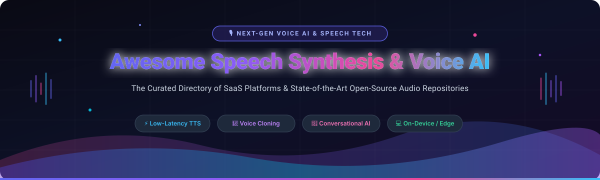

<div align="center">



# 🎙️ Awesome Speech Synthesis & Voice AI Ecosystem

[](https://awesome.re)
[](https://github.com/ishandutta2007/Awesome-Speech-Synthesis-Voice-AI)
[](https://github.com/ishandutta2007/Awesome-Speech-Synthesis-Voice-AI)
[](https://github.com/ishandutta2007/Awesome-Speech-Synthesis-Voice-AI/pulls)
[](https://github.com/ishandutta2007/Awesome-Speech-Synthesis-Voice-AI)
[](https://opensource.org/licenses/MIT)

**A Curated Directory of SaaS / Hosted Platforms & State-of-the-Art Open-Source GitHub Projects**

*Covering Neural Text-to-Speech (TTS), Zero-Shot Voice Cloning, Real-Time Conversational Voice Agents, Speech-to-Speech Generation, and Local On-Device Speech AI Pipelines.*

**Last updated: November 2026**

</div>

---

## 📌 Executive Summary & SEO Keywords

This repository serves as an authoritative index for machine learning engineers, audio researchers, and full-stack builders navigating modern **Speech Synthesis & Voice AI**. Whether deploying low-latency WebSocket APIs for voice assistants, spinning up zero-shot voice cloning architectures, or running offline speech synthesis on edge devices (Raspberry Pi, Apple Silicon, NVIDIA RTX GPUs), this directory indexes the best production-grade tools.

**Target Topics & Keywords:** `speech-synthesis`, `voice-ai`, `text-to-speech`, `tts`, `voice-cloning`, `speech-to-speech`, `zero-shot-tts`, `conversational-ai`, `voice-agents`, `kokoro-tts`, `gpt-sovits`, `elevenlabs`, `f5-tts`, `local-voice-ai`.

---

## 📖 Table of Contents

- [📊 Sector Overview & Market Dynamics](#-sector-overview--market-dynamics)
- [☁️ Top SaaS & Hosted Voice AI Platforms](#️-top-saas--hosted-voice-ai-platforms)
- [💻 Open-Source GitHub Projects (Ranked by Stars)](#-open-source-github-projects-ranked-by-stars)
- [🛠️ Voice AI Architectural Frameworks](#️-voice-ai-architectural-frameworks)
- [🤝 How to Contribute](#-how-to-contribute)
- [⚖️ Ethical Use & Disclaimer](#️-ethical-use--disclaimer)

---

## 📊 Sector Overview & Market Dynamics

The global Speech Synthesis & Voice AI market is valued at approximately **$3.2B–$4.2B in 2025** and is projected to surge past **$7.5B by 2026**, registering a rapid compound annual growth rate (**CAGR of ~31%**). 

The industry exhibits a **moderately fragmented, bifurcated competitive landscape**:
- **Enterprise & Hyperscaler Tier:** Cloud giants (Google Cloud, AWS Polly) and hyper-growth venture unicorns (ElevenLabs at $22B valuation) anchor high-throughput commercial APIs and enterprise conversational agent pipelines.
- **Dynamic Open-Source & Specialized Layer:** A vibrant, decentralized open-source research ecosystem (GPT-SoVITS, CosyVoice, Kokoro, F5-TTS, Coqui) rapidly closes the quality gap with zero-shot voice cloning and on-device quantization, preventing absolute winner-take-all monopolization and enabling self-hosted, privacy-first deployments.

---

## ☁️ Top SaaS & Hosted Voice AI Platforms

Below is a breakdown of top commercial and hosted voice AI platforms, sorted by **Valuation / Company Scale (Descending)**.

| 🏢 Platform | 💰 Valuation / Revenue Scale | 🏷️ Starting Pricing Tier | 🎁 Free Tier / Trial Limits | 🔍 Core Capabilities & Specialties |
| :--- | :--- | :--- | :--- | :--- |
| **[Google Cloud Text-to-Speech](https://cloud.google.com/text-to-speech)** | **$2.2T+ Market Cap** (Alphabet) | Pay-as-you-go: **$4.00 / 1M chars** (Standard/WaveNet) or **$16.00 / 1M chars** (Neural2) | **4,000,000 chars/month** free forever (Standard/WaveNet) + 1,000,000 chars/month free (Neural2/Polyglot/Chirp) | Enterprise hyperscaler API powered by DeepMind WaveNet, Neural2, and Chirp 3 HD voices across 50+ languages and dialects. |
| **[Amazon Polly](https://aws.amazon.com/polly/)** | **$2.1T+ Market Cap** (Amazon AWS) | Pay-as-you-go: **$4.00 / 1M chars** (Standard), **$16.00 / 1M chars** (Neural), **$30.00 / 1M chars** (Generative) | **12-Month Free Tier:** 5,000,000 chars/month (Standard) + 1,000,000 chars/month (Neural) | Managed AWS cloud service turning text to lifelike speech with SSML customization, speech marks, and S3 audio caching rights. |
| **[ElevenLabs](https://elevenlabs.io)** | **$22B Valuation** (~$600M ARR) | **$6 / month** (Starter plan; 30,000 credits/month) | **10,000 credits/month** free forever (~10 mins audio, non-commercial only, attribution required) | Industry-leading generative voice AI with ultra-low latency, instant/professional voice cloning, dubbing, and ElevenAgents conversational engine. |
| **[Descript](https://descript.com)** | **$550M Valuation** (~$50M ARR) | **$12 / editor / month** (Hobbyist plan billed annually) | **60 mins/month (1 media hr)** transcription/editing free forever + 100 AI credits (watermark-free 720p export) | AI video/podcast editor with Overdub voice cloning, transcript-based editing, filler word removal, and studio sound processing. |
| **[PlayHT (PlayAI)](https://play.ht)** | **$84M Valuation** (Acquired by Meta; ~$7M ARR) | **$39 / month** (Creator tier; or ~$31.20/mo billed annually) | **12,500 characters one-time / month** evaluation tier (non-commercial use, preview voice library) | Low-latency streaming conversational speech API, expressive emotion models, and enterprise conversational voice agent infrastructure. |
| **[Speechify](https://speechify.com/)** | **$100M Valuation** (~$18M ARR) | **$139 / year** (~$11.58/mo billed annually) or **$29 / month** | **Free forever plan:** 10 standard reading voices, up to 1.5x reading speed, 5 stored mobile library files | Direct-to-consumer and enterprise voice reader, OCR photo-to-speech scanner, PDF/web narration, and voiceover studio. |
| **[WellSaid Labs](https://wellsaidlabs.com)** | **$75M Valuation** (~$8.3M ARR) | **$19 / month** ($10/mo billed annually; Starter tier with commercial rights) | **7-day free trial** with 3 downloaded audio minutes & 50 audio clips (strictly evaluation, no commercial rights) | Studio-grade corporate voiceovers, high-fidelity brand voice consistency, instructional design modules, and shared team dictionaries. |
| **[Murf.ai](https://murf.ai)** | **$75M Valuation** (~$10M ARR) | **$19 / month** ($228 billed annually) or **$29 / month** (Creator tier) | **Free plan:** 10 minutes total voice generation/audition allowance across all voices (no downloads, personal evaluation only) | Studio voiceover suite for e-learning and YouTube creators with word-level pitch, emphasis, speed, and pronunciation control. |
| **[Resemble AI](https://resemble.ai)** | **$50M Valuation** (~$2M–$5M ARR) | **Pay-as-you-go Flex:** **$0.006 / second** (~$0.36/min audio) | **Free Pay-As-You-Go account:** 1 user seat, pay-per-second consumption, access to custom voice cloning & deepfake detection | Enterprise synthetic voice platform offering instant voice cloning, real-time speech-to-speech, Perth neural watermarking, and deepfake detection. |
| **[LOVO (Genny)](https://lovo.ai)** | **$6.5M Funded** *(Chapter 7 Liquidation)* | **$29 / month** (Basic tier; historically $24/mo annual) | **14-day free trial:** 20 mins voice generation, 3-5 downloads with watermark, personal evaluation only | Cloud AI voice generator and video editing suite with 500+ voices across 100+ languages (currently legacy/insolvent). |

---

## 💻 Open-Source GitHub Projects (Ranked by Stars)

Below is the complete index of state-of-the-art open-source text-to-speech models, zero-shot voice cloning libraries, and real-time audio frameworks, sorted by **GitHub Stars (Descending)**.

| 🌟 Repository & Project | 📊 GitHub Stars | 📜 License | 🎯 Key Architecture & Highlights |
| :--- | :---: | :---: | :--- |
| **[GPT-SoVITS](https://github.com/RVC-Boss/GPT-SoVITS)** | [](https://github.com/RVC-Boss/GPT-SoVITS/stargazers) | MIT | SOTA few-shot voice cloning web UI capable of cloning reference timbre from 5-second audio samples; cross-lingual synthesis in English, Japanese, and Chinese. |
| **[Coqui TTS](https://github.com/coqui-ai/TTS)** | [](https://github.com/coqui-ai/TTS/stargazers) | MPL-2.0 | Legendary deep learning toolkit for TTS; battle-tested in research & production, home to **XTTS-v2** 17-language streaming zero-shot cloning. |
| **[ChatTTS](https://github.com/2noise/ChatTTS)** | [](https://github.com/2noise/ChatTTS/stargazers) | CC-BY-NC 4.0 | Generative conversational speech foundation model trained for spontaneous multi-speaker dialogue, laughing, sighs, interjections, and natural pauses. |
| **[Bark](https://github.com/suno-ai/bark)** | [](https://github.com/suno-ai/bark/stargazers) | MIT | Transformer-based text-prompted audio generation model by Suno; synthesizes realistic multilingual speech, singing voice, background noise, and musical score. |
| **[OpenVoice](https://github.com/myshell-ai/OpenVoice)** | [](https://github.com/myshell-ai/OpenVoice/stargazers) | MIT | Instant voice cloning framework by MyShell & MIT separating tone color from style; flexible control over emotion, accent, rhythm, and cross-lingual cloning. |
| **[Fish Speech](https://github.com/fishaudio/fish-speech)** | [](https://github.com/fishaudio/fish-speech/stargazers) | Apache-2.0 / CC | Leading dual-autoregressive multilingual TTS architecture trained on millions of hours of audio; ultra-fast zero-shot cloning with WebUI and API serving. |
| **[Chatterbox](https://github.com/resemble-ai/chatterbox)** | [](https://github.com/resemble-ai/chatterbox/stargazers) | MIT | Production-grade open-source TTS family by Resemble AI supporting 23+ languages, emotion exaggeration conditioning, paralinguistic tags, and Perth watermarking. |
| **[CosyVoice](https://github.com/FunAudioLLM/CosyVoice)** | [](https://github.com/FunAudioLLM/CosyVoice/stargazers) | Apache-2.0 | Alibaba Tongyi Speech multi-lingual voice generator (v2/v3); zero-shot cloning, instruction-based emotion control, multi-speaker dialogue, and streaming inference. |
| **[FunASR](https://github.com/modelscope/FunASR)** | [](https://github.com/modelscope/FunASR/stargazers) | Apache-2.0 | Full-stack industrial speech recognition, VAD, timestamp estimation, and speech serving toolkit by Alibaba ModelScope. |
| **[Pipecat](https://github.com/pipecat-ai/pipecat)** | [](https://github.com/pipecat-ai/pipecat/stargazers) | BSD-2-Clause | Ultra-low latency open-source framework for building real-time multimodal voice AI agents, WebRTC pipelines, and voice assistant applications. |
| **[Sherpa-ONNX](https://github.com/k2-fsa/sherpa-onnx)** | [](https://github.com/k2-fsa/sherpa-onnx/stargazers) | Apache-2.0 | Offline-first, cross-platform runtime (ONNX) for TTS and ASR; runs natively on Linux, macOS, Windows, Android, iOS, Raspberry Pi, and RISC-V across 12 languages. |
| **[F5-TTS](https://github.com/SWivid/F5-TTS)** | [](https://github.com/SWivid/F5-TTS/stargazers) | MIT | Non-autoregressive speech synthesis based on Flow Matching with DiT backbone; eliminates phoneme alignment while achieving ultra-natural zero-shot cloning. |
| **[LiveKit Agents](https://github.com/livekit/agents)** | [](https://github.com/livekit/agents/stargazers) | Apache-2.0 | Orchestration framework for building real-time, low-latency conversational voice and video AI agents with built-in turn detection and WebRTC. |
| **[FluidVoice](https://github.com/altic-dev/FluidVoice)** | [](https://github.com/altic-dev/FluidVoice/stargazers) | GPL-3.0 | Local-first macOS speech dictation and voice AI application powered by on-device models with zero cloud dependencies and instant transcription. |
| **[PaddleSpeech](https://github.com/PaddlePaddle/PaddleSpeech)** | [](https://github.com/PaddlePaddle/PaddleSpeech/stargazers) | Apache-2.0 | Industrial speech toolkit covering self-supervised pre-training, SOTA streaming ASR, high-speed neural TTS, speaker verification, and translation. |
| **[Piper](https://github.com/rhasspy/piper)** | [](https://github.com/rhasspy/piper/stargazers) | MIT | Fast, local neural text-to-speech system optimized for Home Assistant, Raspberry Pi, and local edge computing via ONNX Runtime. |
| **[Kokoro](https://github.com/hexgrad/kokoro)** | [](https://github.com/hexgrad/kokoro/stargazers) | Apache-2.0 | Breakthrough lightweight 82M-parameter open-weight TTS model generating studio-grade natural speech at 10x-50x real-time on standard consumer CPUs and GPUs. |
| **[EmotiVoice](https://github.com/netease-youdao/EmotiVoice)** | [](https://github.com/netease-youdao/EmotiVoice/stargazers) | Apache-2.0 | NetEase Youdao prompt-controlled, multi-voice emotional speech synthesizer generating speech with distinct mood states (happy, angry, sad). |
| **[VALL-E X](https://github.com/Plachtaa/VALL-E-X)** | [](https://github.com/Plachtaa/VALL-E-X/stargazers) | MIT | Open-source reproduction of Microsoft's VALL-E X neural codec language model for cross-lingual zero-shot speech synthesis and voice cloning. |
| **[VITS](https://github.com/jaywalnut310/vits)** | [](https://github.com/jaywalnut310/vits/stargazers) | MIT | Foundational end-to-end conditional variational autoencoder with adversarial learning for real-time, expressive speech synthesis. |
| **[MeloTTS](https://github.com/myshell-ai/MeloTTS)** | [](https://github.com/myshell-ai/MeloTTS/stargazers) | MIT | High-quality multilingual TTS engineered for real-time CPU synthesis across English, Spanish, French, Chinese, Japanese, and Korean. |
| **[Zonos](https://github.com/Zyphra/Zonos)** | [](https://github.com/Zyphra/Zonos/stargazers) | Apache-2.0 | Open-weights 44kHz speech model trained on 200k+ hours of multilingual speech; conditions on speaking rate, pitch, and emotion parameters. |
| **[eSpeak NG](https://github.com/espeak-ng/espeak-ng)** | [](https://github.com/espeak-ng/espeak-ng/stargazers) | GPL-3.0 | Ultra-compact, lightweight formant speech synthesizer supporting 100+ languages; widely used as the phonemizer backend for deep TTS pipelines. |
| **[StyleTTS 2](https://github.com/yl4579/StyleTTS2)** | [](https://github.com/yl4579/StyleTTS2/stargazers) | MIT | Human-level text-to-speech utilizing style diffusion and adversarial training with SLMs for natural prosody and voice imitation. |
| **[WhisperSpeech](https://github.com/WhisperSpeech/WhisperSpeech)** | [](https://github.com/WhisperSpeech/WhisperSpeech/stargazers) | MIT | Inverted Whisper text-to-speech model by Collabora; fast, natural acoustic modeling designed for multi-speaker synthesis. |
| **[TensorFlowTTS](https://github.com/TensorSpeech/TensorFlowTTS)** | [](https://github.com/TensorSpeech/TensorFlowTTS/stargazers) | Apache-2.0 | Real-time state-of-the-art speech synthesis suite in TensorFlow 2 supporting Tacotron 2, FastSpeech 2, Multi-Band MelGAN, and HiFi-GAN. |
| **[Coqui TTS Maintenance Fork](https://github.com/idiap/coqui-ai-TTS)** | [](https://github.com/idiap/coqui-ai-TTS/stargazers) | MPL-2.0 | Community maintenance fork by Idiap Research Institute preserving Coqui TTS packages and compatibility for modern PyTorch and CUDA versions. |
| **[OpenedAI Speech](https://github.com/matatonic/openedai-speech)** | [](https://github.com/matatonic/openedai-speech/stargazers) | MIT | OpenAI-API-compatible drop-in local TTS microservice wrapping Kokoro-82M, Piper, and XTTS-v2 for seamless integration into existing apps. |
| **[Step-Audio](https://github.com/stepfun-ai/Step-Audio)** | [](https://github.com/stepfun-ai/Step-Audio/stargazers) | Apache-2.0 | StepFun open-source expressive speech foundation model and audio editor supporting dialectal synthesis and emotion control. |

---

## 🛠️ Voice AI Architectural Frameworks

```
                      +------------------------------------------+
                      |         User Input (Text / Audio)        |
                      +--------------------+---------------------+
                                           |
                                           v
    +--------------------------------------+--------------------------------------+
    |                                                                             |
    v                                                                             v
+-------------------------------+                             +-------------------------------+
|     Cloud SaaS Endpoints      |                             |   Self-Hosted / Local Stack   |
| (ElevenLabs, Google, AWS, etc)|                             |  (Kokoro, F5-TTS, GPT-SoVITS) |
+---------------+---------------+                             +---------------+---------------+
                |                                                             |
                +------------------------------+------------------------------+
                                               |
                                               v
                             +-----------------------------------+
                             |     Real-Time Orchestration       |
                             |   (Pipecat / LiveKit Agents)      |
                             +-----------------+-----------------+
                                               |
                                               v
                             +-----------------------------------+
                             | Low-Latency Streaming Audio Output |
                             +-----------------------------------+
```

### 🧩 Recipes for Building Autonomous Voice Agents:
- **100% Local & Private Pipeline:** Combine **Whisper** (Speech-to-Text) + **Ollama / vLLM** (LLM inference) + **Kokoro-82M or Chatterbox** (TTS via **OpenedAI Speech**) orchestrated with **Pipecat**.
- **Enterprise High-Throughput Pipeline:** Combine **Deepgram Nova-2** (STT) + **Claude 3.5 / GPT-4o** (LLM) + **ElevenLabs Turbo v2.5 / PlayAI** (TTS) orchestrated via **LiveKit Agents**.

---

## 🤝 How to Contribute

Contributions, bug reports, and updates are welcomed!

1. 🍴 **Fork** the repository.
2. 🌿 **Create a branch** (`git checkout -b feature/add-new-tts-engine`).
3. 📝 **Add/Update entries**:
   - For **SaaS**: Add platform name, website URL, company scale/valuation, starting tier pricing, and free tier/trial limits.
   - For **Open-Source**: Provide the GitHub repo link, star badge (`style=social&color=white`), license, and core architecture summary.
4. 🚀 **Submit a Pull Request** with a descriptive summary of your additions.

---

## ⚖️ Ethical Use & Disclaimer

- 📜 **Community Curated:** This repository is an independent community-curated index. Company names, trademarks, and logos belong to their respective owners.
- 🛡️ **Consent & Ethics:** Voice cloning technologies must be used responsibly. Always acquire express, documented consent before cloning any individual's voice, and ensure compliance with regional synthetic media disclosure regulations.
- 📑 **Licensing:** Verify the underlying model weight licenses (e.g., Apache-2.0 and MIT vs. CC-BY-NC research-only clauses) prior to commercial deployment.

---

<div align="center">

**⭐ Star this repository if it helps your Voice AI workflow! ⭐**

*Built for audio engineers, ML researchers, and indie developers crafting the future of voice.*

</div>